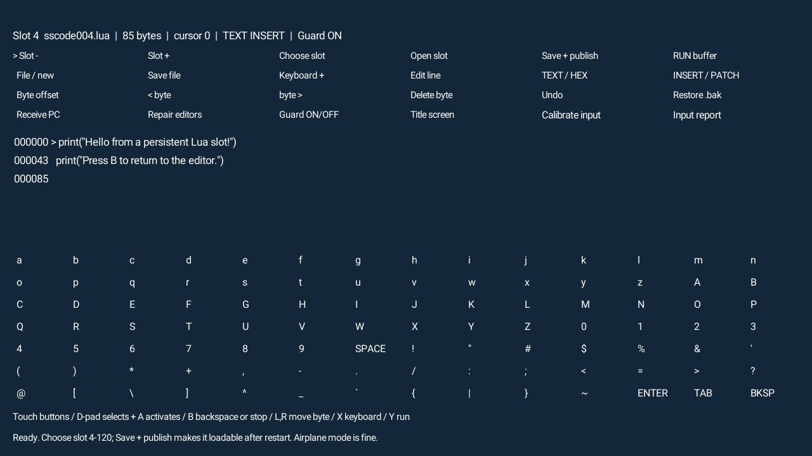
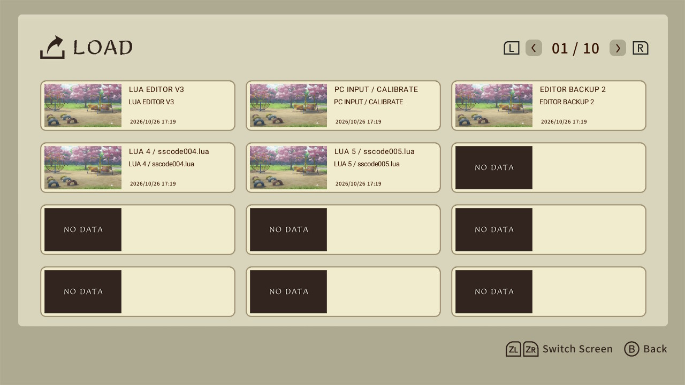
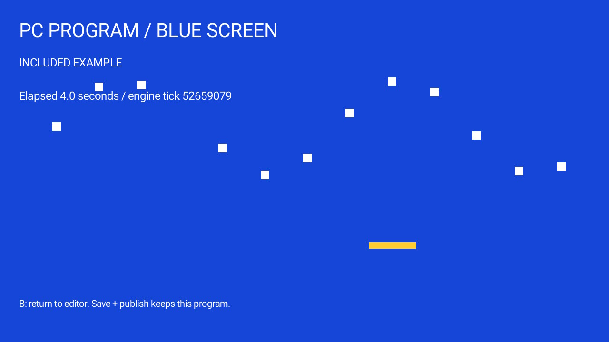

# Seedsow Lua Editor

> [!IMPORTANT]
> **JUST FUTURE-PROOFING? GET THE EDITOR SAVE ONTO SWITCH 2 FIRST.**
> Follow the [beginner installation guide](docs/01-console-install.md), then check
> that the editor loads after fully restarting the game. **Everything else can
> wait.** Keep the game, its save, recovery slots and a backup.

Write, save and run Lua inside Seedsow Lullaby on Switch 1 or Switch 2. The editor
works with a controller and on-screen character grid, or a wired USB keyboard.
It also edits text, hex and ordinary files in the game's own save storage.

**Vibecoded:** built with AI assistance and hands-on console testing. Expect rough
edges. This project has not confirmed an Artemis-based route to a broader exploit;
installing the editor does not guarantee any future exploit or continued transfer
availability.

## Install the already-built save

**For this installation route, start with a modded/hacked Switch 1 that can run
homebrew and can complete Nintendo's online save transfer.** Your Switch 2 does
not need to be modded. A Switch 2 alone cannot perform the initial JKSV restore.

1. Have the same Seedsow Lullaby demo edition installed on both consoles. Link
   the intended save user on each console to the **same Nintendo Account**.
   The account used to download the demo need not itself be that save user.
2. [Download **Seedsow-Lua-Editor-Save.zip**](https://github.com/DialingSpoon527/seedsow-lua-editor/releases/latest/download/Seedsow-Lua-Editor-Save.zip).
   **It is already built.** You do not need Python, a clean autosave, developer
   hashes, the source bundle or a Raspberry Pi.
3. On Switch 1, use **JKSV** to back up the demo's save, then restore the downloaded
   ZIP for the intended user. Start the demo and load **editor slot 1**.
4. Close the game. On both consoles, use **System Settings > Data Management >
   Transfer Your Save Data** to move that user's demo save to Switch 2.
5. Load **slot 1** on Switch 2, fully close and restart the game, then load it again.
   **If you only want to prepare for later, stop here.**

[Follow the complete step-by-step installation guide](docs/01-console-install.md).
It covers JKSV installation, the SD card folders, backups, restoring and transfer.
Restoring replaces the chosen save; keep your original backup. An existing editor
installation does not need the starter restored over its saved programs.

**Networking:** the initial official save transfer requires Nintendo connectivity
and account verification on both consoles. Blocking Nintendo servers beforehand
can prevent it. The documented route uses an online-capable **sysNAND/sysMMC** on
Switch 1; this describes the workflow, not a technical restriction of the transfer
feature to physical NAND. An isolated emuMMC normally blocks Nintendo connectivity.
Using CFW on sysNAND is **not ban-proof**. See the guide before changing your setup.
Once installed, editing, saving and running Lua require no Nintendo connection.

## Compatibility

| Status | Configuration | What is established |
| --- | --- | --- |
| Tested | Demo 1.0.0 obtained from the US eShop; Switch 1 and Switch 2 | Console editing, save/reload after a full restart, and the original PC/controller upload path worked on hardware. |
| Plausible, untested | Other regional demos, full game, other game versions | Not established as compatible or incompatible. The US copy is a tested reference, not a proven requirement. |
| Local checks only | Current PC/Pi packaging and alongside-editor update | Automated checks pass; a fresh hardware trial is pending. |
| Cannot complete this installation route | Stock Switch 1 for JKSV restore; source unable to contact Nintendo for official transfer | These block particular installation steps, not Lua execution in an already-installed editor. |

[Compatibility evidence, title IDs and transfer requirements](docs/compatibility.md).
No other game edition has been established as incompatible by this project.

## Use the editor

| Slot | Purpose |
| --- | --- |
| 1 | Main editor |
| 2 | Optional upload calibration and receiver |
| 3 | Backup editor |
| 4-120 | Your Lua programs; examples are included in slots 4 and 5 |

Open slot 1, edit a program, then choose **Save + publish** into a user slot.
Load that slot from the game's menu to run it again. Learn the
[console controls](docs/07-console-editor.md) and keep recovery slots 1-3.
Compatible editor updates can be installed in a fresh user slot later; see
[updates and recovery](docs/04-updates-recovery.md).

## Optional uploads from a computer

**Windows and Raspberry Pi describe the implemented upload workflow, not a
requirement for running Lua.** A Pi is a very convenient option if you have one:
the Windows companion sends files over your LAN to a Pi, which acts as a Bluetooth
controller. The console uses Bluetooth input; its Wi-Fi and Nintendo servers are
not used for these uploads. A real wired USB keyboard can also enter text directly.

For the optional companion, download the companion/source ZIP, keep its folders
together, install Python 3.10+ with Tcl/Tk on Windows, and open **START WINDOWS.cmd**.
Follow [Pi setup](docs/02-pi-setup.md), then [send a file](docs/03-send-files.md).
Controller uploads are slow: a tiny proof takes around a minute; a 5.6 KB editor
update can take about 25-36 minutes. The 1 MiB file limit is a storage limit,
not a practical upload size.

## On the console

  

<em>Edit, run and save Lua directly on the console.</em>

<table>
  <tr>
    <td align="center" width="50%">
       
      <strong>Editor and program slots</strong> 
      Open the editor or load a saved program from the game's menu.
    </td>
    <td align="center" width="50%">
       
      <strong>Included example</strong> 
      The blue animation runs inside the game.
    </td>
  </tr>
</table>

## Guides and source layout

- [Beginner installation](docs/01-console-install.md), [console controls](docs/07-console-editor.md), and [troubleshooting](docs/05-troubleshooting.md).
- [General development](docs/06-development.md): compatible-save builders in `editor/`, shared save utilities in [`tools/`](tools/README.md), and regression tests in `tests/`.
- Optional Windows companion in `pc/`; optional Raspberry Pi bridge in `pi/`.
- [Maintainers](maintainer/README.md): reviewed starter reconstruction, exact validation hashes, source packaging, release publication and historical implementation details in `maintainer/`.

## License

**No credit required.** Project-owned code and documentation are available under
the [BSD Zero Clause license (0BSD)](LICENSE). You may use, modify, share or sell
them without naming the author or keeping this project's copyright or license
notice. The software is provided as-is, without warranty.

This 0BSD permission also applies to project-owned code and documentation in
earlier commits and releases, including versions originally published under MIT.
Existing MIT permissions remain available.

Third-party components and game content retain their own licenses and rights;
see [Third-party notices](THIRD_PARTY_NOTICES.md). For example, NXBT's MIT notice
must still be preserved when distributing NXBT.

The release includes a reviewed starter save and a separate companion/source
ZIP. Keep your own later backups and connection files private.
