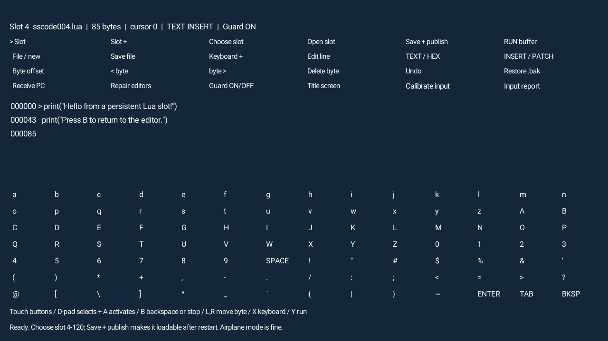
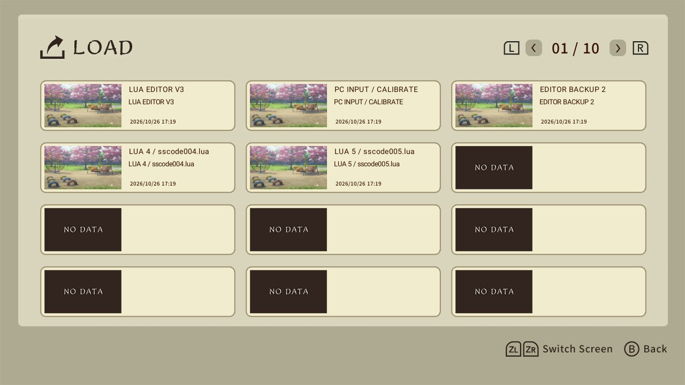
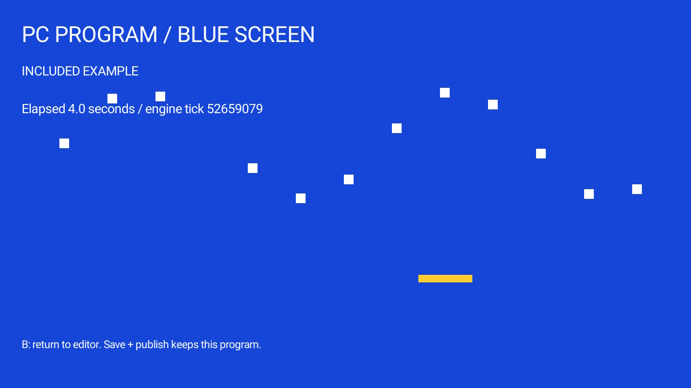

# Seedsow Lua Editor

> [!IMPORTANT]
> **JUST FUTURE-PROOFING? GET THE EDITOR SAVE ONTO SWITCH 2 FIRST.**
> The editor gives you Lua execution inside Seedsow Lullaby and access to the
> game's own save files. Install it now as a foothold that nintendo cannot take
> for when a future Artemis exploit is released.
> Follow the [beginner installation guide](docs/01-console-install.md) to transfer
> the save. **Once the transfer finishes, you can stop.** Keep the game, its save,
> recovery slots and a backup. Loading the editor can wait until you want to use it.
> If you already have smileBasic, this is not neccesary!

**Firmware checkpoint (2026-10-27):** this preparation guide targets **23.0.1
on both consoles while it is current**. If a newer firmware is released, stop
before updating and read the [firmware guidance](docs/01-console-install.md).
Future FS preparation can be affected even if the Lua editor still runs.

Write, save and run Lua inside Seedsow Lullaby on Switch 1 or Switch 2. The editor
works with a controller and on-screen character grid, or a wired USB keyboard.
It also edits text, hex and ordinary files in the game's own save storage.

**Vibecoded:** built with AI assistance and hands-on console testing. Expect rough
edges.

## New here? Start with the Switch save

| Download | Use it for | What to do with it |
| --- | --- | --- |
| **Seedsow-Lua-Editor-Save.zip** | First installation on Switch | Restore with JKSV on your hacked Switch 1, then transfer the save to Switch 2. |
| **Seedsow-PC-Companion-and-Source-VERSION.zip** | Optional Windows or Mac uploads via Pi, update building and development | Extract on your computer; see [launch instructions](#optional-uploads-from-a-computer). |

For a first installation, download the **Switch save ZIP** and follow the steps
below. You can use the editor entirely on the console afterward. Older releases
name the PC bundle `seedsow-lua-editor-VERSION.zip`; it serves the same role.
GitHub's automatic **Source code** archives are for development.

**For this installation route, start with a modded/hacked Switch 1 that can run
homebrew and can complete Nintendo's online save transfer.** Your Switch 2 does
not need to be modded. A Switch 2 alone cannot perform the initial JKSV restore.

**Use sysNAND/sysMMC throughout, not emuNAND/emuMMC.** Download and transfer on
stock; boot CFW on that same sysNAND only to back up and restore with JKSV.
Stock and CFW sysNAND share the internal save; emuNAND has a separate save.

1. For the nearby/local transfer below, install the same Seedsow Lullaby demo on
   both consoles. **The full game and an NSO membership are not required.** Link
   the intended save user on each console to the **same Nintendo Account**.
   The account used to download the demo need not itself be that save user.
2. [Download **Seedsow-Lua-Editor-Save.zip**](https://github.com/DialingSpoon527/seedsow-lua-editor/releases/latest/download/Seedsow-Lua-Editor-Save.zip).
   **It is already built.** You do not need Python, a clean autosave, developer
   hashes, the source bundle or a Raspberry Pi.
3. On Switch 1 in **stock sysMMC**, start **New Game** and hold **R** until normal
   dialogue. Release **R**, press **ZL** to open the **save menu**, then choose an
   empty slot and save. **JKSV will only recognize the game for that user after
   you have made at least one save.** Close the game, boot **CFW sysMMC**, and use
   **JKSV** to back up that user's save and restore the downloaded ZIP. Return
   to **stock sysMMC**, start the demo and load **editor slot 1**. These boot
   modes use the same internal save storage.
4. Close the game. On both consoles, use **System Settings > Data Management >
   Transfer Your Save Data** to move that user's demo save to Switch 2.
5. **If you only want to prepare for later, stop once the transfer finishes.**
   Keep the game, its save, recovery slots and a backup. Loading the editor or
   examples on Switch 2 can wait until you want to use them.

[Follow the complete step-by-step installation guide](docs/01-console-install.md).
It covers JKSV installation, the SD card folders, backups, restoring and transfer.
See the [full-game setup](docs/01-console-install.md#1c--full-game-alternative-online-license-on-switch-1).
Online License controls game access; **NSO Save Data Cloud** is a separate,
membership-based way to copy the same *full-game* save between consoles.
A demo save cannot be transferred to the full game. If you own the digital full
game, **Online License** lets the purchasing user launch it on Switch 1 while
online without loading its virtual game card there.
Restoring replaces the chosen save; keep your original backup. An existing editor
installation does not need the starter restored over its saved programs.

**Networking:** both nearby/local transfer and NSO cloud backup require Nintendo
connectivity and account verification. **Nearby/local transfer still needs both
consoles connected to Nintendo's servers.** Blocking Nintendo servers beforehand
can prevent it. Use **stock sysNAND/sysMMC** on Switch 1 for either transfer
method, after restoring with JKSV under CFW on that same sysNAND.
Using CFW on sysNAND is **not ban-proof**. See the guide before changing your setup.
Once installed, editing, saving and running Lua require no Nintendo connection.

## Compatibility

| Status | Configuration | What is established |
| --- | --- | --- |
| Tested | Demo 1.0.0 obtained from the US eShop; Switch 1 and Switch 2 | Console editing, save/reload after a full restart, and the original PC/controller upload path worked on hardware. |
| Reported working by users | Japanese demo, EU demo, US full game | Working cases reported as of 2026-10-27; not independently reproduced by the maintainer. Exact versions and feature coverage were not recorded. |
| Plausible, untested | Other regions, editions and game versions without reports | Not established as compatible or incompatible. The US demo is a tested reference, not a requirement. |
| Reported working by user | 0.1.3 alongside-editor update via Mac/Raspberry Pi | Built for another slot using the original installation as the base, transferred and reported working on console on 2026-10-28. |
| Local checks only | Fresh PC/Pi installation | A fresh installer trial remains pending; the update report used an existing setup. |
| Cannot complete this installation route | Stock Switch 1 for JKSV restore; source unable to contact Nintendo for official transfer | These block particular installation steps, not Lua execution in an already-installed editor. |

[Compatibility evidence, title IDs and transfer requirements](docs/compatibility.md).
No other game edition has been established as incompatible by this project.

## Use the editor

| Slot | Purpose |
| --- | --- |
| 1 | Main editor |
| 2 | Optional upload calibration and receiver |
| 3 | Backup editor |
| 4-120 | Your Lua programs; examples are included in slots 4 and 5 |

Open slot 1, edit a program, then choose **Save + publish** into a user slot.
Load that slot from the game's menu to run it again. Learn the
[console controls](docs/07-console-editor.md) and keep recovery slots 1-3.
Compatible editor updates can be installed in a fresh user slot later; see
[updates and recovery](docs/04-updates-recovery.md).

Fresh saves built from this source open the current editor directly in slot 1,
including line movement, scrolling and a visible insertion cursor. Older
installations can add it in a fresh user slot using the [update guide](docs/04-updates-recovery.md).
The 0.1.3 fresh-save build was reported working on console on 2026-10-27.
That report does not establish a complete regression pass for every feature.
Release 0.1.3 includes this editor in the prepared Switch save. Existing
installations can keep their programs and use the update methods linked above.

## Optional uploads from a computer

**The desktop companion works on Windows and has user-reported support on macOS.**
It sends files over your LAN to a Raspberry Pi, which acts as a Bluetooth
controller. The console uses Bluetooth input; its Wi-Fi and Nintendo servers are
not used for these uploads. This setup is optional; the editor also works directly
on the console with its controller grid or a wired USB keyboard's text-entry dialog.

**Airplane mode can stay ON, including during pairing.** Enable only its
Bluetooth/controller exception and leave console Wi-Fi OFF. Pairing, calibration
and uploads do not require turning airplane mode off. Nintendo's initial official
save transfer is a separate step that requires internet connectivity.

Download **Seedsow-PC-Companion-and-Source-VERSION.zip**, extract it and keep its
folders together. The companion needs **Python 3.10+ with Tcl/Tk** and no pip packages.

**Windows:** install Python with Tcl/Tk and open **START WINDOWS.cmd**.

**Mac:** in Terminal, open the extracted project folder containing `pc/` and run:

```sh
python3 pc/app.py
```

If Tk support is missing, the reported working Mac setup added it with Homebrew:

```sh
brew install python-tk
```

Then launch with `python3 pc/app.py`. Use the Python installation that has Tk
support; Python being installed alone does not guarantee that Tk is available.

Follow [Pi setup](docs/02-pi-setup.md), then [send a file](docs/03-send-files.md).
Controller uploads are slow. Use the companion's estimate for the actual file;
an editor update can take an hour or more. The 1 MiB file limit describes storage.

## On the console

<p align="center">
  <a href="docs/images/console-editor.jpg"></a>
</p>
<p align="center"><em>Edit, run and save Lua directly on the console.</em></p>

<table>
  <tr>
    <td align="center" width="50%">
      <a href="docs/images/save-menu.jpg"></a><br>
      <strong>Editor and program slots</strong><br>
      <sub>Open the editor or load a saved program from the game's menu.</sub>
    </td>
    <td align="center" width="50%">
      <a href="docs/images/included-example.jpg"></a><br>
      <strong>Included example</strong><br>
      <sub>The blue animation runs inside the game.</sub>
    </td>
  </tr>
</table>

## Guides and source layout

- [Beginner installation](docs/01-console-install.md), [console controls](docs/07-console-editor.md), and [troubleshooting](docs/05-troubleshooting.md).
- [General development](docs/06-development.md): compatible-save builders in `editor/`, shared save utilities in [`tools/`](tools/README.md), and regression tests in `tests/`.
- Optional Windows/macOS desktop companion in `pc/`; optional Raspberry Pi bridge in `pi/`.
- [Maintainers](maintainer/README.md): reviewed starter reconstruction, exact validation hashes, source packaging, release publication and historical implementation details in `maintainer/`.

## License

**No credit required.** Project-owned code and documentation are available under
the [BSD Zero Clause license (0BSD)](LICENSE). You may use, modify, share or sell
them without naming the author or keeping this project's copyright or license
notice. The software is provided as-is, without warranty.

This 0BSD permission also applies to project-owned code and documentation in
earlier commits and releases, including versions originally published under MIT.
Existing MIT permissions remain available.

Third-party components and game content retain their own licenses and rights;
see [Third-party notices](THIRD_PARTY_NOTICES.md). For example, NXBT's MIT notice
must still be preserved when distributing NXBT.

The release includes a reviewed starter save and a separate companion/source
ZIP. Keep your own later backups and connection files private.
